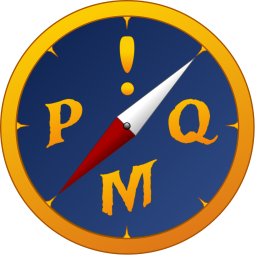

  

<h1 align="center">PlayerMadeQuests</h1>

> PlayerMadeQuests is **no longer being maintained**. Anyone is welcome to fork this project and continue its development. You can download the final release from the links below. The contents of the wiki have been copied to [this site](https://runeberry.github.io/PlayerMadeQuests/) for your reference.
>
> If you have questions, stop by our [Discord](https://discord.gg/gHMjCgs) server! I'll be glad to help however I can. If you're interested in continuing to develop PMQ, you can fork the [repository](https://github.com/runeberry/PlayerMadeQuests) on GitHub, and publish your own versions of the addon.
>
> To everyone out there who enjoyed the addon, thank you for your support!

* Download PMQ from [CurseForge](https://www.curseforge.com/wow/addons/pmq)
* Download the latest release in a zip file directly from [Github](https://github.com/runeberry/PlayerMadeQuests/releases)
* Read the docs [here](https://runeberry.github.io/PlayerMadeQuests)
